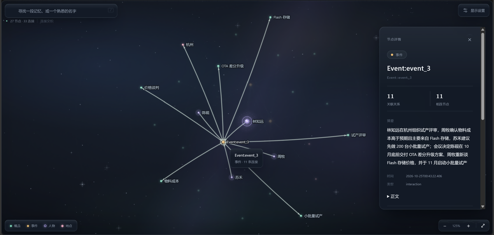

# dsh-neo4j-memory

给 DeepSeek Harness（DSH）用的长期图记忆插件。

只向模型提供两个工具：

- `memory_database_save(content)`：提取事件、人物、概念、地点和关系，写入 Neo4j。
- `memory_database_search(...)`：摘要与原文两路混合检索（RRF 融合 + MMR 去冗），默认返回最多 4 个事件的紧凑证据；支持读取原文、沿概念继续检索和补读来源附近记录。

记忆按“事件 + 实体 + 关系”组织，不是聊天记录切片。只有显式调用保存工具的内容才会被写入；插件不扫描聊天记录。

> 说明：这是一个纯 vibe coding 项目，使用 `GPT6.1-Sol` 与 `deepseek-v4.1-flash-1017` 完成。功能和主要链路在真实环境里跑过；请把它当成一个可读、可改的开源原型，而不是生产级产品。

## 特性

- 四类节点：`Event`、`Person`、`Concept`、`Location`；四类关系：`PARTICIPATED_IN`、`OCCURRED_AT`、`MENTIONS`、`HAS_ATTITUDE`
- 首次调用自动下载本地 Neo4j 5.26.30 + Temurin JRE 21（约 211 MB），无需系统 Java；也可连外部 Neo4j
- 设置页：三组模型 Key 与端点、概念对齐开关与阈值、向量维度、重新向量化
- 只读图谱页：查看实际写入的节点、关系和属性（导入上限 5,000 节点 / 30,000 关系）
- 写入是一个 Neo4j 事务，失败回滚
- Key、端点、模型、阈值、维度保存后下一次调用生效
- 节点 ID 按类型自增：`event_1`、`person_2`、`concept_3`……

## 效果

以下截图由一段合成对话生成，人物、地点与数值均为虚构。


点击节点查看属性与一跳关系：



## 要求

- Windows 10/11 x64
- DSH `>=0.2.1-rc.2 <0.3.0`
- Node.js 22+（桌面宿主内置）
- 提取与向量 API Key；概念对齐 Key 可选

## 安装

桌面版插件页（推荐）：

1. 打开 **插件 → 添加插件**。
2. 输入 `dsh-neo4j-memory`，按提示安装。
3. 安装完成后重启 DSH（或按插件页提示重载），在 **设置 → Neo4j 记忆** 配置 Key。

命令行安装（PowerShell；路径按你的实际安装位置调整）：

```powershell
$cli = "D:\DeepSeek Harness\resources\runtime\cli\bin\dsh.cmd"
& $cli plugin --profile desktop add dsh-neo4j-memory
```

也可以直接从 GitHub 安装：

```powershell
$cli = "D:\DeepSeek Harness\resources\runtime\cli\bin\dsh.cmd"
& $cli plugin --profile desktop add github:shuunO-O/dsh-neo4j-memory
```

`--profile desktop` 是桌面版默认 profile；如果你用的是其他 profile，换成对应名称。

## 配置

安装并启用后打开 **设置 → Neo4j 记忆**：

- **API Key**（默认折叠）：提取、向量、概念对齐三组
- **模型端点与阈值**（默认折叠）：三组 Base URL 与模型名、概念对齐阈值（80%–99%）
- **向量维度**：默认 1024，必须与向量模型实际输出一致；修改后点「重新向量化」
- **数据库**：本地/外部模式、外部 Neo4j 密码、本地数据目录

| 用途 | 默认服务 / 模型 |
|---|---|
| 提取 | DeepSeek / `deepseek-flash` |
| 向量 | DashScope / `qwen3.7-text-embedding`，1024 维 |
| 概念对齐 | TypeSafe / `jev`，阈值 0.95 |

概念对齐填的是**完整 endpoint**：TypeSafe 为 `https://api.typesafe.ai/v1/systemone`，OpenRouter 为 `https://openrouter.ai/api/alpha/decisions`。用 OpenRouter 时模型可填 `typesafe/jev-1.13` 或 `typesafe/jev-1.14`；换模型后建议重新校准阈值。

保存后，Key、端点、模型、阈值、维度在下一次调用时生效；本地数据目录、Neo4j 模式、外部密码需要重启 DSH。Key 保存在当前 profile 配置中，不回显，也不进入对话。

### 向量维度与重新向量化

不同模型或不同维度的向量不能比较，Neo4j 的向量索引也固定维度。插件把当前模型与维度记录在 `MemoryMeta` 节点里；配置变化后，保存和语义搜索会被拒绝，直到重新向量化。

设置页「向量索引」区域会显示当前库的模型、维度、节点数，并提供「重新向量化」按钮。操作会重算所有记忆节点的向量、重建四个向量索引；新向量先暂存，全部计算成功后才替换旧向量并更新元数据。

### 本地 Neo4j

默认 `DSH_NEO4J_MEMORY_NEO4J_MODE=auto`：没有配置外部 URI/密码时使用本地实例，首次调用工具时下载并启动。数据、日志、`state.json` 位于 `%LOCALAPPDATA%\dsh-neo4j-memory\`，可在设置页改到其他可写目录（需重启）。

同一时间只建议运行一个使用托管模式的 DSH 实例。想让本地实例在 DSH 退出后继续运行，设置 `DSH_NEO4J_MEMORY_NEO4J_KEEP_RUNNING=1`。

排障日志：

- `%LOCALAPPDATA%\dsh-neo4j-memory\provision.log`
- `%LOCALAPPDATA%\dsh-neo4j-memory\logs\console.log`

Neo4j Community 采用 GPLv3，Temurin JRE 采用 GPLv2+CE；插件不随包分发这些二进制，首次运行时从官方地址下载。

## 环境变量（可选）

插件配置优先于环境变量。

| 变量 | 默认值 |
|---|---|
| `DEEPSEEK_API_KEY` / `EMBEDDING_API_KEY` / `TYPESAFE_API_KEY` | 无；提取、向量、对齐 Key |
| `DSH_NEO4J_MEMORY_NEO4J_MODE` | `auto`（`auto` / `managed` / `external`） |
| `DSH_NEO4J_MEMORY_NEO4J_URI` | `bolt://localhost:7687`（external） |
| `NEO4J_PASSWORD` | 无；external 必填 |
| `DSH_NEO4J_MEMORY_RUNTIME_DIR` | `%LOCALAPPDATA%\dsh-neo4j-memory` |
| `DSH_NEO4J_MEMORY_EXTRACTION_URL` / `_MODEL` | `https://api.deepseek.com` / `deepseek-flash` |
| `DSH_NEO4J_MEMORY_EMBEDDING_URL` / `_MODEL` | DashScope compatible / `qwen3.7-text-embedding` |
| `DSH_NEO4J_MEMORY_EMBEDDING_DIMENSIONS` | `1024` |
| `DSH_NEO4J_MEMORY_ALIGNMENT_URL` / `_MODEL` | `https://api.typesafe.ai/v1/systemone` / `jev` |
| `DSH_NEO4J_MEMORY_ALIGNMENT_THRESHOLD` | `0.95`（0.80–0.99） |
| `DSH_NEO4J_MEMORY_CONCEPT_ALIGNMENT` | `true`；设为 `0`/`false` 关闭 |
| `DSH_NEO4J_MEMORY_TIMEZONE` | `Asia/Shanghai` |

外部 Neo4j 需支持向量索引与 `vector.similarity.cosine`（如 Neo4j 5.23+）。

## 工作方式

```text
保存：content
  → 提取事件/实体/关系
  → 生成事件摘要与实体名向量
  → 概念对齐（可选）
  → 一个 Neo4j 事务写入

检索：query / entity / date
  → 摘要与原文两路向量候选（各 40）
  → RRF 融合 + MMR 去冗
  → 原摘要 + 短原文 + 共享 Concept + 继续入口
  → 主 Agent 按需读取原文、沿 Concept 追查、补读来源记录
```

图谱页：**设置 → Neo4j 记忆 → 展开图谱**，或访问 `/dsh-neo4j-memory/graph/`。只读，不写回 Neo4j；导出 JSON 只影响浏览器视图。

### 检索算法

一次 `search`（`target_label=Event`）分五步，全部在本地完成，不额外调用模型：

1. **两路候选**：问题向量分别检索事件摘要与原文分块，各取前 40，合并后最多 80 个不同候选；候选先按实体、写入日期和已交付 ID 过滤。
2. **融合重排**：两路名次用 RRF 融合（`k = 60`），再加查询词项覆盖 `0.10`。
3. **控制冗余**：完整原文相同的事件只保留一个代表；MMR 在相关性与已选证据的相似度之间折中（`λ = 0.85`，冗余取向量余弦与来源分块重叠的较大值）。
4. **小批量交付**：每次最多交付 4 个新事件；追查链剩余额度不足时按余额交付，不因凑不满整批而整批拒收。失败的调用不占用名额。
5. **按需核对**：首轮给摘要 + 最多 120 字符的原文摘录（整包预算 1,000 字符，取自 content 前 32,000 字符），模型再用 `read` / `nearby` / `expand` 补读原文、同章邻近记录或经共享 Concept 扩展。

接口与升级细节见[检索接口](docs/retrieval.md)，混合检索与纯向量检索的逐题对照见 [public/dawn-retrieval-study](public/dawn-retrieval-study/README.md)。

### 检索和继续追查

首次调用方式不变，例如 `{"query_text":"Neo4j 的部署方式和方案演进"}`。默认 `target_label=Event`，每次最多返回 4 个事件，每个事件最多附 120 个字符的原文，全包摘录预算 1,000 字符；完整来源按需读取。模型看到紧凑结构化文字，内部界面数据、向量和配置不进入返回。

| operation | 参数 | 用途 |
|---|---|---|
| `search`（默认） | `query_text` / `entity_filter` / `time_hint` 至少一项 | 返回最多 4 个事件、原文和追查入口 |
| `read` | `event_id`，可选 `start` / `limit` | 按范围读取事件的 content；无需模型 Key |
| `expand` | `cursor` / `concept_id`，可选 `limit` | 经返回的 Concept 补取事件，默认 3 个；只返回新增内容 |
| `nearby` | `cursor` / `event_id`，可选 `before` / `after` | 有章号和导出记录号时，补读同章相邻编号；只返回新增内容 |

继续追查复用原问题向量和筛选条件，不增加提取或向量 API 调用。cursor 绑定当前会话，15 分钟内有效，重启后需重新检索；每条追查链累计最多 20 个事件。共享概念和来源邻近只代表检索线索，不等于因果或发生顺序。ID 直接使用 `event_1` / `concept_3`，不额外添加类型前缀或临时编号。

`Person` / `Concept` 的定向实体检索继续使用原来的前三条和一跳上下文。详细返回格式、边界和升级兼容说明见 [检索接口](docs/retrieval.md)。

## 当前限制

- 提取与合并较粗：仅单次抽取；概念按名称/别名 + 向量 + 两两判同，不保证一定准确。
- 初始事件召回依赖摘要与原文分块向量；旧记忆没有原文分块时只能靠摘要命中。沿概念扩展不能补回数据库里缺失的关系，也不保证关键事实完整。
- `time_hint` 过滤写入日期；仅有 `create_time` 时不会把它当成事件发生时间。普通 `event_123` ID 不提供可靠来源顺序，需有章号/记录号才能补读邻近来源。
- 图谱只读：没有删除、合并、编辑节点/关系的 UI。
- `0.7.0`，没有完整 benchmark；唯一的对照实验见 [public/dawn-retrieval-study](public/dawn-retrieval-study/README.md)，只覆盖《黎明之剑》前 500 章、18 道开发题与 6 道新题，不覆盖其他记忆场景；仅在 Windows x64 上测试过。

## 开发

```powershell
npm ci --legacy-peer-deps
npm run build
node selfcheck.mjs
node tests/backend.test.mjs
npm pack
```

- `src/` 是 TypeScript 源码，`lib/` 是编译产物，`assets/` 是提取提示词，`web/graph/` 是图谱页面。
- `npm test` 使用 `node --test`；`DSH_NEO4J_MEMORY_INTEGRATION=1 node tests/integration.test.mjs` 可跑真实 Neo4j 集成测试。
- `npm publish` 会先执行 `prepublishOnly`：构建 + selfcheck + 后端测试；`npm pack` 会先构建。

## 隐私

- 记忆库在本机，但提取/向量/对齐会把内容发给你配置的模型 API。
- API Key 存在当前 DSH profile 的配置里，不进入对话或模型上下文。
- 不要把密码、密钥或不想发给模型服务的内容存进记忆库。

## 许可证

MIT，见 [LICENSE](LICENSE)。
